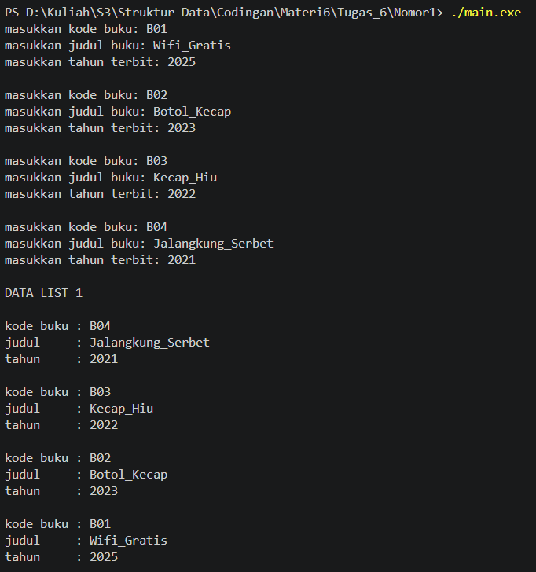
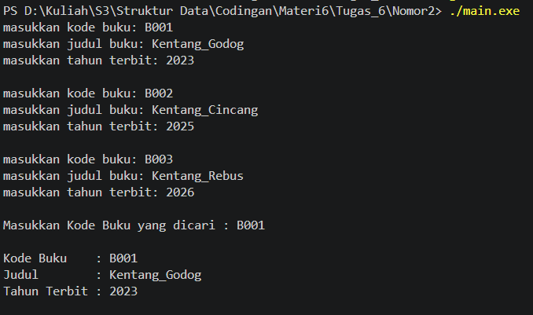
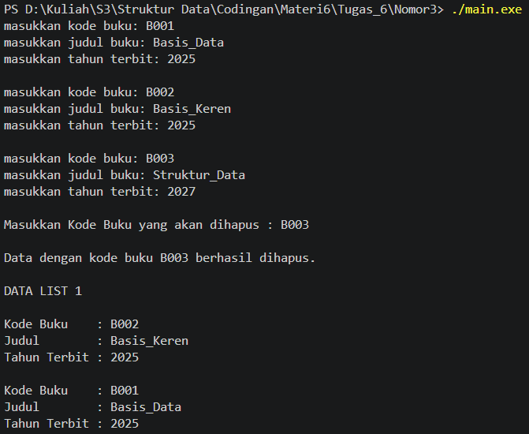

# <h1 align="center">Modul 5 SINGLY LINKED LIST (BAGIAN KEDUA) </h1>
<p align="center">Gilang Haryo Yudianto- 109082500021</p>

### A. Konsep Dasar Double Linked List
Double Linked List (List Berkait Ganda) merupakan pengembangan dari Singly Linked List di mana setiap node atau elemennya memiliki dua buah pointer (link), yaitu next untuk menunjuk ke node berikutnya dan prev untuk menunjuk ke node sebelumnya. Berbeda dengan Singly Linked List yang penelusurannya hanya berjalan satu arah (maju), Double Linked List memungkinkan penelusuran secara dua arah (bi-directional traversal), yaitu maju dari first ke last maupun mundur dari last ke first.

### B. Searching pada Double Linked List
Proses pencarian (searching) pada Double Linked List jauh lebih fleksibel karena penelusuran tidak harus selalu dimulai dari elemen pertama (first).

#### 1. Pencarian Maju (Forward Searching)
Penelusuran dimulai dari first lalu bergerak maju menggunakan pointer next hingga menemukan node yang dicari atau mencapai Nil. Metode ini sangat efektif jika node yang dicari diperkirakan berada di area depan list.

#### 2. Pencarian Mundur (Backward Searching)
Penelusuran dimulai dari last lalu bergerak mundur menggunakan pointer prev hingga menemukan node yang dicari atau mencapai Nil. Metode ini jauh lebih cepat dibandingkan Singly Linked List apabila node yang dicari berada dekat dengan akhir list.

#### 3. Jenis-Jenis Pencarian Node
Pencarian Berdasarkan Data: Menelusuri list dari depan atau belakang untuk mencari node yang isi datanya cocok dengan kriteria (misalnya berdasarkan NIM atau Nama).

Pencarian Berdasarkan Alamat: Memastikan ketersediaan sebuah pointer node tertentu di dalam list dengan membandingkan alamat pointernya.

Pencarian Berdasarkan Rentang Data (Range): Menelusuri seluruh node (dari first ke last) untuk mengumpulkan atau menampilkan semua node yang nilainya berada pada rentang tertentu. Berbeda dengan pencarian biasa, penelusuran ini tidak berhenti pada node pertama yang cocok karena bisa terdapat lebih dari satu node yang memenuhi syarat.

### C. Hubungan Searching dengan Operasi Akses Dua Arah
Adanya pointer prev pada Double Linked List membuat operasi berbasis acuan (reference node) seperti insertAfter, insertBefore, deleteAfter, dan deleteBefore menjadi sangat efisien.
Melalui proses searching, jika suatu node acuan (misal P) berhasil ditemukan:

Node setelahnya dapat diakses langsung melalui P->next.

Node sebelumnya dapat diakses langsung melalui P->prev tanpa harus melakukan penelusuran ulang dari awal list (first).

### D. Operasi Update pada Double Linked List
Operasi update adalah operasi dasar untuk memperbarui atau mengubah data yang ada di dalam node pada list. Proses ini biasanya diawali dengan pencarian terhadap node yang akan diubah. Terdapat beberapa bentuk update pada Double Linked List:

#### 1. Update First
Mengubah data pada node pertama list, yaitu node yang ditunjuk langsung oleh first.

#### 2. Update Last
Mengubah data pada node terakhir list. Karena Double Linked List memiliki penunjuk last, pengubahan data pada elemen terakhir dapat dilakukan secara instan tanpa perlu menelusuri list dari awal.

#### 3. Update After
Mengubah data pada node yang berada tepat setelah node acuan tertentu (P->next). Operasi ini hanya dapat dilakukan jika node acuan valid dan memiliki successor.

#### 4. Update Before
Mengubah data pada node yang berada tepat sebelum node acuan tertentu (P->prev). Operasi ini hanya dimungkinkan karena adanya pointer penunjuk ke belakang pada Double Linked List.

### 1. File Doublylist.h

```C++
#ifndef DOUBLYLIST_H
#define DOUBLYLIST_H

#include <iostream>
#include <string>

#define Nil NULL

// Latihan 1
struct infotype {
    std::string nopol; 
    std::string warna; 
    int thnBuat;      
};
typedef struct elmlist *address;
struct elmlist {
    infotype info;  
    address next;   
    address prev;   
};
struct List {
    address First; 
    address Last;  
};


// Latihan 1
void CreateList(List &L);
address alokasi(infotype x);
void dealokasi(address &P);
void printInfo(List L);
void insertLast(List &L, address P);

// Latihan 2

address findElm(List L, std::string nopol);

// Latihan 3
void deleteFirst(List &L, address &P);
void deleteLast(List &L, address &P);
void deleteAfter(List &L, address Prec, address &P);
void deleteElm(List &L, std::string nopol, bool &status);

#endif
```
Kode tersebut merupakan header file (doublylist.h) C++ untuk struktur ADT Double Linked List yang memodelkan data kendaraan. File ini mendefinisikan komponen utama list, termasuk infotype (berisi nopol, warna, dan tahun), elemen list bertipe pointer ganda (next dan prev), serta kontrol list (First dan Last). Selain definisi struktur, terdapat deklarasi prototipe untuk manajemen memori, penambahan data (insertLast), pencarian (findElm), penampilan data (printInfo), serta serangkaian fungsi menghapus node (deleteFirst, deleteLast, deleteAfter, dan deleteElm).

### 2. File Doublylist.cpp

```C++
#include "Doublylist.h"

// Latihan 1
void CreateList(List &L) {
    L.First = Nil;
    L.Last = Nil;
}

address alokasi(infotype x) {
    address P = new elmlist;
    P->info = x;
    P->next = Nil;
    P->prev = Nil; 
    return P;
}

void dealokasi(address &P) {
    delete P;
}

void printInfo(List L) {
    address P = L.Last;
    if (P == Nil) {
        std::cout << "List kosong." << std::endl;
        return;
    }
    while (P != Nil) {
        std::cout << "no polisi : " << P->info.nopol << std::endl;   
        std::cout << "warna     : " << P->info.warna << std::endl;   
        std::cout << "tahun     : " << P->info.thnBuat << std::endl; 
        P = P->prev;
    }
}

void insertLast(List &L, address P) {
    if (L.First == Nil) { 
        L.First = P;
        L.Last = P;
    } else {
        P->prev = L.Last;         
        (L.Last)->next = P;     
        L.Last = P;               
    }
}

// Latihan 2
address findElm(List L, std::string nopol) {
    address P = L.First;
    while (P != Nil) {
        if (P->info.nopol == nopol) {
            return P;
        }
        P = P->next;
    }
    return Nil;
}

// Latihan 3
void deleteFirst(List &L, address &P) {
    if (L.First == Nil) return;

    P = L.First; 
    if (L.First == L.Last) { 
        L.First = Nil;
        L.Last = Nil;
    } else {
        L.First = P->next;     
        (L.First)->prev = Nil; 
        P->next = Nil;         
    }
}

void deleteLast(List &L, address &P) {
    if (L.First == Nil) return;

    P = L.Last; 
    if (L.First == L.Last) { 
        L.First = Nil;
        L.Last = Nil;
    } else {
        L.Last = P->prev;      
        (L.Last)->next = Nil; 
        P->prev = Nil;         
    }
}

void deleteAfter(List &L, address Prec, address &P) {
    if (Prec == Nil || Prec->next == Nil) return;

    P = Prec->next;
    if (P == L.Last) {
        deleteLast(L, P);
    } else {
        Prec->next = P->next;     
        (P->next)->prev = Prec; 
        P->next = Nil;            
        P->prev = Nil;           
    }
}

void deleteElm(List &L, std::string nopol, bool &status) {
    address P = findElm(L, nopol);
    status = false;

    if (P != Nil) {
        if (P == L.First) {
            deleteFirst(L, P);
        } else if (P == L.Last) {
            deleteLast(L, P);
        } else {
            address Prec = P->prev;
            deleteAfter(L, Prec, P);
        }
        dealokasi(P); 
        status = true;
    }
}
```
File doublylist.cpp berisi realisasi fungsi standar untuk mengelola Double Linked List. Fitur utama yang diimplementasikan adalah inisialisasi list (CreateList), manajemen memori node (alokasi & dealokasi), cetak data terbalik (printInfo), penyisipan di akhir (insertLast), dan pencarian data nomor polisi (findElm). Operasi penghapusan juga tersedia lengkap, mencakup penghapusan di awal (deleteFirst), di akhir (deleteLast), setelah node tertentu (deleteAfter), serta penghapusan data spesifik (deleteElm).


### 3. File main.cpp

```C++
 #include <iostream>
#include "Doublylist.h"
using namespace std;

void inputData(List &L) {
    infotype data;
    address P;

    cout << "masukkan nomor polisi: "; cin >> data.nopol;
    cout << "masukkan warna kendaraan: "; cin >> data.warna;
    cout << "masukkan tahun kendaraan: "; cin >> data.thnBuat;
    if (findElm(L, data.nopol) == Nil) {
        P = alokasi(data); 
        insertLast(L, P);  
    } else {
        cout << "nomor polisi sudah terdaftar" << endl; 
    }
}

int main() {
    List L;
    CreateList(L); 
    address P;

    // Latihan 1
    inputData(L); 
    inputData(L); 
    inputData(L); 
    inputData(L); 

    cout << "\nDATA LIST 1" << endl; 
    printInfo(L); 

    // Latihan 2
    string nopolCari;
    cout << "\nMasukkan Nomor Polisi yang dicari : "; 
    cin >> nopolCari; 
    
    P = findElm(L, nopolCari); 
    if (P != Nil) {
        cout << "Nomor Polisi : " << P->info.nopol << endl; 
        cout << "Warna        : " << P->info.warna << endl; 
        cout << "Tahun        : " << P->info.thnBuat << endl; 
    } else {
        cout << "Data dengan nomor polisi " << nopolCari << " tidak ditemukan." << endl;
    }

    // Latihan 3
    string nopolHapus;
    bool hapusBerhasil;
    cout << "\nMasukkan Nomor Polisi yang akan dihapus : ";
    cin >> nopolHapus;

    deleteElm(L, nopolHapus, hapusBerhasil); 

    if (hapusBerhasil) {
        cout << "Data dengan nomor polisi " << nopolHapus << " berhasil dihapus." << endl; 
    } else {
        cout << "Data dengan nomor polisi " << nopolHapus << " tidak ditemukan." << endl;
    }
    cout << "\nDATA LIST 1" << endl; 
    printInfo(L); 

    return 0;
}
```
Kode utama (main.cpp) ini berfungsi sebagai driver untuk menguji dan menerapkan operasi Double Linked List dari modul pendukung. Program dimulai dengan inisialisasi list, lalu memanggil fungsi inputData sebanyak empat kali untuk menambahkan data kendaraan unik ke bagian akhir list. Setelah mencetak seluruh data, program melakukan pencarian kendaraan berdasarkan nomor polisi (findElm), mengeksekusi penghapusan elemen tertentu (deleteElm) sesuai input pengguna, dan diakhiri dengan menampilkan status terbaru dari list tersebut.

## Unguided 

### 1. Pembuatan ADT Dasar dan Insert Data 


### Buku.h
```C++
#ifndef BUKU_H
#define BUKU_H

#include <iostream>
#include <string>

#define Nil NULL

struct infotype {
    std::string kodeBuku;
    std::string judul;
    int thnTerbit;
};

typedef struct ElmList *address;

struct ElmList {
    infotype info;
    address next;
    address prev;
};

struct List {
    address First;
    address Last;
};
 
void CreateList(List &L);
address alokasi(infotype x);
void dealokasi(address &P);
void printInfo(List L);
void insertLast(List &L, address P);
address findElm(List L, std::string kodeBuku); 

#endif
```

### Buku.cpp 
```C++
#include "Buku.h"

void CreateList(List &L) {
    L.First = Nil;
    L.Last = Nil;
}

address alokasi(infotype x) {
    address P = new ElmList;
    P->info = x;
    P->next = Nil;
    P->prev = Nil;
    return P;
}

void dealokasi(address &P) {
    delete P;
}

void printInfo(List L) {
    address P = L.Last;
    if (P == Nil) {
        std::cout << "List kosong." << std::endl;
        return;
    }
    while (P != Nil) {
        std::cout << "kode buku : " << P->info.kodeBuku << std::endl;
        std::cout << "judul     : " << P->info.judul << std::endl;
        std::cout << "tahun     : " << P->info.thnTerbit << std::endl;
        std::cout << std::endl;
        P = P->prev;
    }
}

void insertLast(List &L, address P) {
    if (L.First == Nil) {
        L.First = P;
        L.Last = P;
    } else {
        P->prev = L.Last;
        (L.Last)->next = P;
        L.Last = P;
    }
}

address findElm(List L, std::string kodeBuku) {
    address P = L.First;
    while (P != Nil) {
        if (P->info.kodeBuku == kodeBuku) {
            return P;
        }
        P = P->next;
    }
    return Nil;
}
```


### main.cpp 
```C++
#include <iostream>
#include "Buku.h"

using namespace std;

void inputData(List &L) {
    infotype data;
    address P;

    cout << "masukkan kode buku: "; cin >> data.kodeBuku;
    cout << "masukkan judul buku: "; cin >> data.judul;
    cout << "masukkan tahun terbit: "; cin >> data.thnTerbit;
    cout << endl;
 
    if (findElm(L, data.kodeBuku) == Nil) {
        P = alokasi(data);
        insertLast(L, P);
    } else {
        cout << "kode buku sudah terdaftar" << endl << endl;
    }
}

int main() {
    List L;
    CreateList(L);
 
    inputData(L);  
    inputData(L);  
    inputData(L);  
    inputData(L);  

    cout << "DATA LIST 1" << endl << endl;
    printInfo(L);

    return 0;
}
```
### Output Unguided 1 :

##### Output 1


Rangkaian kode program di atas merupakan implementasi struktur data Doubly Linked List secara modular menggunakan bahasa C++ yang terbagi ke dalam tiga file utama, yaitu file header (Buku.h), file body (Buku.cpp), dan file program utama (main.cpp) untuk mengelola data buku perpustakaan. Modul ini mendefinisikan tipe data bentukan infotype yang mencakup atribut kodeBuku, judul, serta thnTerbit, lengkap dengan struktur elemen berpointer ganda (next dan prev) untuk mendukung fleksibilitas penelusuran data dari dua arah.

Di dalam file realisasi dan program utama, sistem mengimplementasikan berbagai operasi primitif seperti CreateList, alokasi, insertLast, printInfo, serta fungsi findElm yang digunakan untuk memvalidasi pencegahan duplikasi kodeBuku sebelum data baru dimasukkan ke dalam list. Melalui file main.cpp, program mengeksekusi serangkaian pengujian masukan data termasuk menguji penanganan kode buku yang sudah terdaftar lalu menampilkan seluruh isi daftar buku secara terbalik dari elemen terakhir ke elemen pertama sesuai struktur Doubly Linked List.


### 2. Pencarian Elemen (Searching) 

### Buku.h 
```C++
#ifndef BUKU_H
#define BUKU_H

#include <iostream>
#include <string>

#define Nil NULL

struct infotype {
    std::string kodeBuku;
    std::string judul;
    int thnTerbit;
};

typedef struct ElmList *address;

struct ElmList {
    infotype info;
    address next;
    address prev;
};

struct List {
    address First;
    address Last;
};
 
void CreateList(List &L);
address alokasi(infotype x);
void dealokasi(address &P);
void printInfo(List L);
void insertLast(List &L, address P);
 
address findElm(List L, infotype x);

#endif
```
### Buku.cpp 
```C++
#include "Buku.h"

void CreateList(List &L) {
    L.First = Nil;
    L.Last = Nil;
}

address alokasi(infotype x) {
    address P = new ElmList;
    P->info = x;
    P->next = Nil;
    P->prev = Nil;
    return P;
}

void dealokasi(address &P) {
    delete P;
}

void printInfo(List L) {
    address P = L.Last;
    if (P == Nil) {
        std::cout << "List kosong." << std::endl;
        return;
    }
    while (P != Nil) {
        std::cout << "kode buku : " << P->info.kodeBuku << std::endl;
        std::cout << "judul     : " << P->info.judul << std::endl;
        std::cout << "tahun     : " << P->info.thnTerbit << std::endl;
        std::cout << std::endl;
        P = P->prev;
    }
}

void insertLast(List &L, address P) {
    if (L.First == Nil) {
        L.First = P;
        L.Last = P;
    } else {
        P->prev = L.Last;
        (L.Last)->next = P;
        L.Last = P;
    }
}
 
address findElm(List L, infotype x) {
    address P = L.First;
    while (P != Nil) {
        if (P->info.kodeBuku == x.kodeBuku) {
            return P;
        }
        P = P->next;
    }
    return Nil;
}
```
### main.cpp 
```C++
#include <iostream>
#include "Buku.h"

using namespace std;

void inputData(List &L) {
    infotype data;
    address P;

    cout << "masukkan kode buku: "; cin >> data.kodeBuku;
    cout << "masukkan judul buku: "; cin >> data.judul;
    cout << "masukkan tahun terbit: "; cin >> data.thnTerbit;
    cout << endl;
 
    if (findElm(L, data) == Nil) {
        P = alokasi(data);
        insertLast(L, P);
    } else {
        cout << "kode buku sudah terdaftar" << endl << endl;
    }
}

int main() {
    List L;
    CreateList(L);
    address P;
 
    inputData(L); 
    inputData(L); 
    inputData(L); 
 
    infotype cariData;
    cout << "Masukkan Kode Buku yang dicari : ";
    cin >> cariData.kodeBuku;
    cout << endl;

    P = findElm(L, cariData);
    if (P != Nil) {
        cout << "Kode Buku    : " << P->info.kodeBuku << endl;
        cout << "Judul        : " << P->info.judul << endl;
        cout << "Tahun Terbit : " << P->info.thnTerbit << endl;
    } else {
        cout << "Data dengan kode buku " << cariData.kodeBuku << " tidak ditemukan." << endl;
    }

    cout << "\nDATA LIST 1" << endl << endl;
    printInfo(L);

    return 0;
}
```
### Output Unguided 2 :

##### Output 2


Rangkaian pembaruan kode tersebut mengimplementasikan fitur pencarian elemen (searching) pada struktur data Doubly Linked List buku, yang didefinisikan melalui purwarupa fungsi findElm di file header (Buku.h) dan direalisasikan pada file body (Buku.cpp). Fungsi ini bekerja dengan menelusuri list secara sekuensial dari elemen pertama (First) menggunakan penunjuk next guna mencocokkan atribut kodeBuku di dalam struktur infotype x yang dicari dengan data yang tersimpan di dalam memori.   Pada file program utama (main.cpp), implementasi ini diuji melalui fitur interaktif di mana pengguna dapat memasukkan kode buku tertentu untuk dicari (seperti B001), dan sistem akan menampilkan rincian informasi lengkap mulai dari kode buku, judul, hingga tahun terbit apabila data tersebut ditemukan. Mekanisme pencarian ini sangat esensial karena selain berfungsi untuk menampilkan data, fungsi ini juga menjadi fondasi penting dalam melakukan validasi pencegahan duplikasi data saat proses penyisipan node baru ke dalam list.

### 3.  Penghapusan Elemen (Delete) 

### Buku.h 
```C++
#ifndef BUKU_H
#define BUKU_H

#include <iostream>
#include <string>

#define Nil NULL

struct infotype {
    std::string kodeBuku;
    std::string judul;
    int thnTerbit;
};

typedef struct ElmList *address;

struct ElmList {
    infotype info;
    address next;
    address prev;
};

struct List {
    address First;
    address Last;
};
 
void CreateList(List &L);
address alokasi(infotype x);
void dealokasi(address &P);
void printInfo(List L);
void insertLast(List &L, address P);
address findElm(List L, infotype x);
 
void deleteFirst(List &L, address &P);
void deleteLast(List &L, address &P);
void deleteAfter(List &L, address Prec, address &P);

#endif
```
### Buku.cpp 
```C++
#include "Buku.h"

void CreateList(List &L) {
    L.First = Nil;
    L.Last = Nil;
}

address alokasi(infotype x) {
    address P = new ElmList;
    P->info = x;
    P->next = Nil;
    P->prev = Nil;
    return P;
}

void dealokasi(address &P) {
    delete P;
}

void printInfo(List L) {
    address P = L.Last;
    if (P == Nil) {
        std::cout << "List kosong." << std::endl;
        return;
    }
    while (P != Nil) {
        std::cout << "Kode Buku    : " << P->info.kodeBuku << std::endl;
        std::cout << "Judul        : " << P->info.judul << std::endl;
        std::cout << "Tahun Terbit : " << P->info.thnTerbit << std::endl;
        std::cout << std::endl;
        P = P->prev;
    }
}

void insertLast(List &L, address P) {
    if (L.First == Nil) {
        L.First = P;
        L.Last = P;
    } else {
        P->prev = L.Last;
        (L.Last)->next = P;
        L.Last = P;
    }
}

address findElm(List L, infotype x) {
    address P = L.First;
    while (P != Nil) {
        if (P->info.kodeBuku == x.kodeBuku) {
            return P;
        }
        P = P->next;
    }
    return Nil;
}
 
void deleteFirst(List &L, address &P) {
    if (L.First == Nil) return;

    P = L.First;
    if (L.First == L.Last) {
        L.First = Nil;
        L.Last = Nil;
    } else {
        L.First = P->next;
        (L.First)->prev = Nil;
        P->next = Nil;
    }
}

void deleteLast(List &L, address &P) {
    if (L.First == Nil) return;

    P = L.Last;
    if (L.First == L.Last) {
        L.First = Nil;
        L.Last = Nil;
    } else {
        L.Last = P->prev;
        (L.Last)->next = Nil;
        P->prev = Nil;
    }
}

void deleteAfter(List &L, address Prec, address &P) {
    if (Prec == Nil || Prec->next == Nil) return;

    P = Prec->next;
    if (P == L.Last) {
        deleteLast(L, P);
    } else {
        Prec->next = P->next;
        (P->next)->prev = Prec;
        P->next = Nil;
        P->prev = Nil;
    }
}
```
### main.cpp 
```C++
#include <iostream>
#include "Buku.h"

using namespace std;

void inputData(List &L) {
    infotype data;
    address P;

    cout << "masukkan kode buku: "; cin >> data.kodeBuku;
    cout << "masukkan judul buku: "; cin >> data.judul;
    cout << "masukkan tahun terbit: "; cin >> data.thnTerbit;
    cout << endl;

    if (findElm(L, data) == Nil) {
        P = alokasi(data);
        insertLast(L, P);
    } else {
        cout << "kode buku sudah terdaftar" << endl << endl;
    }
}

int main() {
    List L;
    CreateList(L);
    address P;
 
    inputData(L);  
    inputData(L);  
    inputData(L); 
 
    string kodeHapus;
    cout << "Masukkan Kode Buku yang akan dihapus : ";
    cin >> kodeHapus;
    cout << endl;

    infotype cariHapus;
    cariHapus.kodeBuku = kodeHapus;
    P = findElm(L, cariHapus);

    if (P != Nil) {
        if (P == L.First) {
            deleteFirst(L, P);
        } else if (P == L.Last) {
            deleteLast(L, P);
        } else {
            address Prec = P->prev;
            deleteAfter(L, Prec, P);
        }
        dealokasi(P);
        cout << "Data dengan kode buku " << kodeHapus << " berhasil dihapus." << endl << endl;
    } else {
        cout << "Data dengan kode buku " << kodeHapus << " tidak ditemukan." << endl << endl;
    }

    cout << "DATA LIST 1" << endl << endl;
    printInfo(L);

    return 0;
}
```
### Output Unguided 3 :

##### Output 3


Rangkaian kode program di atas mengimplementasikan prosedur penghapusan elemen (delete) pada struktur data Doubly Linked List buku, yang mencakup tiga bentuk operasi utama yaitu deleteFirst, deleteLast, dan deleteAfter. Prosedur-prosedur ini mengatur kembali tautan pointer ganda next dan prev secara presisi untuk memutus hubungan node, baik saat elemen yang dihapus berada di posisi awal, akhir, maupun di tengah list.   Pada file program utama (main.cpp), logika penghapusan ini digabungkan dengan fungsi pencarian (findElm) untuk mengidentifikasi keberadaan node berdasarkan kode buku tertentu (seperti B003) yang diinputkan pengguna. Setelah pointer target ditemukan dan diproses oleh prosedur hapus yang sesuai, memori node dibebaskan melalui fungsi dealokasi, lalu program menampilkan kembali daftar buku yang tersisa untuk membuktikan bahwa proses penghapusan berjalan dengan sukses. 

## Kesimpulan
Modul 6 ini mendalami implementasi Doubly Linked List dalam C++ berbasis pointer ganda, yang memungkinkan penelusuran data secara dua arah (forward dan backward) melalui atribut next dan prev. Melalui rangkaian latihan praktikum, struktur data dikemas secara modular ke dalam file header, body, dan driver main.cpp, dimulai dari pembentukan ADT dasar buku (kodeBuku, judul, thnTerbit), alokasi memori, pencetakan data secara terbalik (printInfo), serta penyisipan elemen di akhir list (insertLast) disertai validasi pengecekan duplikasi kodeBuku. Selanjutnya, modul ini mengimplementasikan fungsi pencarian elemen (findElm) untuk mendeteksi keberadaan data spesifik seperti pencarian kode buku B001, serta rangkaian prosedur penghapusan elemen yang fleksibel melalui deleteFirst, deleteLast, dan deleteAfter (seperti penghapusan data buku B003) guna memodifikasi serta memperbarui struktur list secara dinamis.

## Referensi
[1] Deitel, P., & Deitel, H. (2017). C++ How to Program (10th ed.). Boston: Pearson.<br>
[2] Liem, I. (2003). Diktat Pemrograman Prosedural. Bandung: Departemen Teknik Informatika Institut Teknologi Bandung.<br>
[3] Laboratorium Informatika Fakultas Informatika Telkom University. (n.d.). Modul 4: Singly Linked List (Bagian Pertama), Modul Praktikum Struktur Data.<br>
[4] cppreference.com. (n.d.). new expression dan delete expression. https://en.cppreference.com/w/cpp/language/new<br>

